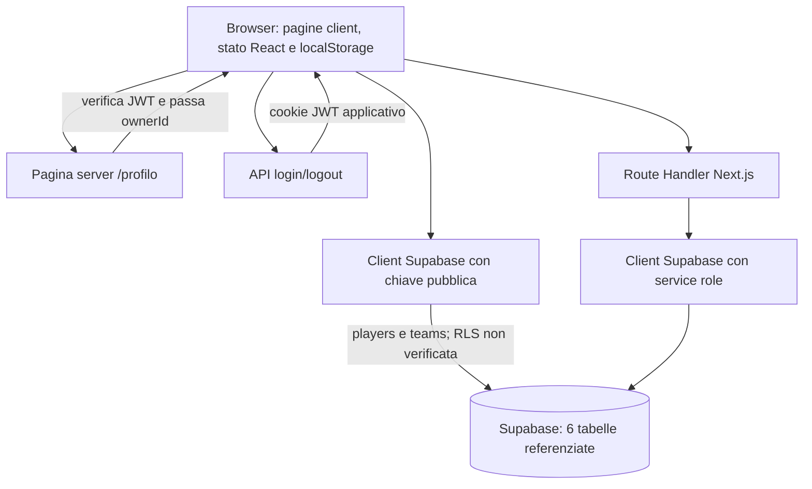

# Fanta Claus — architettura rilevata

## Architettura implementata B03+B04+B05 — 20 novembre 2026

Questa sezione prevale sugli snapshot B01+B02 e 2025 sottostanti. Implementazione locale sul branch esistente `codex/b01-b02`, senza cambi branch, commit o accessi a produzione. Le nuove migrazioni non sono applicate al servizio ospitato. I limiti e la procedura operativa sono nel [runbook](IDENTITY_EDITION_RUNBOOK.md).

```text
src/lib/supabase/           client SSR per richiesta, config pubblica, cookie HttpOnly
src/proxy.ts               getUser, refresh cookie richiesta/risposta, private/no-store
src/lib/auth.ts            identità Supabase verificata, profilo e ruolo DB 2026
src/lib/identity-contracts.ts  avatar e contratti runtime account/edizione/admin
src/lib/edition.ts         stato corrente 2026, errori RPC senza dettagli DB
src/app/auth/              conferma esplicita token hash e fallback PKCE sicuro
src/app/api/auth/          Magic Link e conferma, senza password/codici legacy
src/app/api/profile/       lettura personale, inizializzazione, solo avatar in PATCH
src/app/api/enrollment/    membership corrente, nessun ID caller di partita/edizione
src/app/api/admin/edition/ attivazione manuale e configurazione iscrizioni
src/app/api/admin/participants/  elenco 2026 e correzione nomi con ruolo DB
src/app/profilo/ProfileEditor.tsx, admin/EditionAdmin.tsx  UI temporanee MUI
src/legacy2025/            sorgenti/handler B01+B02 preservati, fuori App Router
supabase/migrations/       tre migrazioni transazionali versionate
supabase/config.toml       stack locale, solo fc_api, Auth conferme e Mailpit
tests/db-integration.mjs   PostgreSQL/PGlite: RLS, ACL, vincoli, legacy, recupero
scripts/test-supabase-local.mjs  integrazione reale predisposta, non eseguita
```

Browser → API/pagine Next → client SSR con chiave pubblica e JWT utente → `fc_api` RPC → tabelle `fc_private`. Il browser non riceve service role, mappa di assegnazioni, profili altrui o dati 2025. Gli endpoint storici ora restituiscono 410 senza query. Le vecchie UI di builder/voti/punteggi restano conservate e testate, ma non sono collegate alle pagine 2026. È una variazione intenzionale: regole 2025 non diventano automaticamente regole 2026.

### Identità, autorizzazioni e sessioni

Supabase Auth UUID separato dal profilo personale; email sempre da Auth verificato. `getUser()` verifica la sessione sul server; ruolo riletto da `edition_admins`, senza fiducia in metadata, cookie legacy, localStorage, header o ID nel body. `@supabase/ssr` 0.12.7 richiede Supabase JS almeno 2.114: installata/bloccata 2.119.2 per rispettare il peer, con lock npm aggiornato. PGlite 0.5.17 è dipendenza soltanto di test. Il resto dello stack B01+B02 è preservato.

Client Auth solo server e cookie HttpOnly, SameSite=Lax, Secure in produzione. Proxy Next 16 aggiorna richiesta e risposta dopo refresh; pagine/API non condividono cache personali. `APP_ORIGIN` determina i redirect, con destinazione fissa e callback consentite. Token hash monouso consumato solo dopo il clic e POST same-origin; PKCE disponibile come fallback. Logout reale Supabase della sessione corrente e cancellazione del vecchio cookie; access JWT copiati restano soggetti alla scadenza standard Supabase, senza promettere revoca istantanea.

GET `/api/session` conserva per compatibilità della navbar il campo visuale `ownerId`, che ora contiene esclusivamente l'UUID Auth verificato; non implica alcuna associazione al vecchio `players.owner_id`. I nuovi contratti personali usano `userId`.

Profilo inizializzato una sola volta: nome/cognome non modificabili dal partecipante, avatar mediante enum applicativo e CHECK DB. Admin per edizione (scelta prudente D03 da confermare) correggono solo partecipanti dell'ufficiale 2026, senza poteri su Secret Santa. Procedura privilegiata di concessione/revoca non esposta; nessun admin seeded. Bootstrap del primo account separato e monouso. Guard Auth blocca cambio UUID/email/password successiva; consente il temporaneo hash interno GoTrue e lo elimina alla verifica email. La compatibilità del guard con GoTrue reale è ancora da collaudare.

### Database, edizione e storico

`fc_private`: `profiles`, `editions`, `edition_admins`, `games`, `game_config`, `participations`, `secret_assignments`, `auth_bootstrap`. RLS abilitata/forzata su tutte; niente DML diretto per ruoli client. SELECT solo sui propri profilo/ruoli/membership. Le RPC esplicitamente autorizzate applicano verifiche server/DB e operazioni composte in transazione. RPC definer con search_path vuoto e proprietario infrastrutturale BYPASSRLS verificato; nessun ruolo applicativo acquisisce tale privilegio. Default globali del ruolo migratore e default per schema chiusi per i futuri oggetti; grant espliciti, nessun EXECUTE pubblico automatico.

Solo l'ufficiale 2026 è disponibile nell'app normale. Edizione inizialmente inattiva, iscrizioni chiuse senza date inventate. Attivazione con conferma testuale amministrativa distinta dall'apertura iscrizioni. Account, accesso e membership sono passaggi distinti: login esistenti resta consentito dopo chiusura; trigger su creazione Auth e RPC di iscrizione controllano gate/tempo DB anche fuori UI. Join e chiusura coordinati tramite row lock; retry su membership già presente idempotente. Vincoli composti impediscono riferimenti tra partite/edizioni. Contenitori per future simulazioni e assegnazioni predisposti, nessun ciclo simulazione/sorteggio/rivelazione implementato.

La quarantena legacy modifica soltanto RLS e ACL delle sette tabelle `public` esistenti, revocando anche service role. Nessun movimento/cancellazione/riscrittura di righe, nessuna mappatura Auth o reinterpretazione di santa/receiver/punteggi. I CSV documentano parte dello schema: fixture fedele alle informazioni disponibili, non baseline completa. View/RPC/trigger/proprietari non forniti e i due schemi esposti richiedono inventario prima di produzione. In hosting occorre impostare manualmente solo `fc_api` come schema applicativo esposto e disattivare autoesposizione; il config locale non modifica il Dashboard.

### Configurazione e prove

`.env.example`: `SUPABASE_URL`, `SUPABASE_PUBLISHABLE_KEY`, `APP_ORIGIN`; fallback delle variabili pubbliche preesistenti. Service role e `SESSION_SECRET` non servono al percorso 2026. Wrapper CLI locale senza comandi remoti, configurazione callback/template e Mailpit predisposti; CLI assente e Docker daemon non disponibile. Nessun provider SMTP scelto; consegna pubblica non verificata e configurazione SMTP richiesta prima del rilascio.

Build isolata e smoke SSR con stub, test applicativi e PostgreSQL/PGlite hanno evidenze distinte in [AUDIT_REPORT.md](AUDIT_REPORT.md). PGlite verifica motore SQL/RLS reale ma usa fixture per `auth.users`/`auth.uid()` e non esegue GoTrue/PostgREST o concorrenza multi-connessione. Backup directory PGlite, rollback locale e riapplicazione verificati; backup/ripristino Supabase e integrità 2025 reale restano bloccanti. Nessuna migrazione ufficiale pronta prima di tali prove.

## Struttura implementata B01+B02 — 20 novembre 2026

Questa sezione descrive il codice modificato sul branch `codex/b01-b02`. Le sezioni successive preservano lo snapshot storico del 19 novembre: versioni, assenze e vulnerabilità lì descritte non rappresentano lo stato aggiornato. Nessuna modifica a schema, policy, edizioni o dati remoti.

**Stack verificato localmente:** Node 24.14.0, npm 11.11.1, Next/eslint-config-next 16.4.6, React/React DOM 19.2.9, MUI/icone 7.3.6, Supabase JS 2.86.2, jose 6.1.3, TypeScript 5.9.3, ESLint 9.39.1. Aggiunti `server-only` 0.0.1, Vitest 5.1.1, jsdom 29.1.1 e Testing Library React/DOM. Tipi Node allineati a 24; runtime dichiarato Node 24/npm 11. Nessun aggiornamento maggiore di React, MUI o Supabase.

```text
src/lib/
  api.ts              # errori HTTP/no-store, JSON limitato, Origin, validatori primitivi
  auth.ts             # cookie verificato -> players autorevole -> requirePlayer/requireAdmin
  serverConfig.ts     # URL server/service role e SESSION_SECRET >=32 byte
  supabaseAdmin.ts    # client lazy server-only; persistSession/refresh disabilitati
  session.ts          # JWT HS256, cookie e token coerenti per 30 giorni
  settings.ts         # letture fail-closed, flag legacy, ISO, punti e finestre server
  references.ts       # controllo applicativo riferimenti esistenti
  teams.ts            # lettura/validazione team e impronta del contenuto
  writeLock.ts        # serializzazione soltanto nel processo corrente
  leaderboard.ts      # calcolo 2025 condiviso; nessuna inversione santa/receiver
  awards.ts, votes.ts # proiezione premi e tipi/alias canonici
  contracts.ts        # validazione runtime dei nuovi contratti client
  clientApi.ts        # HTTP client e logout/conferma cambio auth
  useAuth.ts          # identità da /api/session, refresh eventi/focus
src/components/VotingPanel.tsx  # voto aggiornato solo dopo persistenza
scripts/              # build con env inerti e smoke HTTP locale
tests/                # query fake, sessioni reali jose, handler e UI jsdom
```

Il client Supabase browser è stato rimosso: nessuna query diretta da componenti a `players` o `teams`. Il cookie legacy non è diventato Supabase Auth; il server usa ancora la service role con controlli espliciti. Non si deduce da questo cambiamento che la Data API sia protetta: chi possiede una chiave pubblica già distribuita resta soggetto ai grant/RLS reali non verificati.

### Confini e contratti effettivi

- `requirePlayer` verifica JWT e player attuale; `requireAdmin` richiede `is_admin === true` letto dal DB. Errori di verifica DB non si trasformano in identità anonima o permesso. ID nel body/query sono verificati rispetto alla sessione; header ID ignorati.
- Tutte le mutazioni amministrative e letture admin (base-data, gifts, awards, vote-points) protette. GET deadline/pubblicazione e categorie restano pubbliche. `?preview=1` richiede admin; il normale GET leaderboard non usa più header o cookie admin per svelare risultati anticipati.
- Nuovo GET `/api/session`: solo identità/nome/ruolo del chiamante oppure null. Nuovo GET/PUT `/api/team`: solo squadra personale; PUT con membri, capitano e versione. Restano **vincoli 2025** (massimo 7, nessun duplicato, capitano membro o null), non regole 2026 approvate.
- Voti GET/POST dalla sessione. POST verifica target, autovoto, tipo canonico, finestra e pubblicazione. Entrambi gli endpoint personali rifiutano impersonificazione; nessuna promozione autonoma.
- Team scrivibile prima della deadline configurata; voti dalla deadline team inclusa alla chiusura 2025 esclusa, in `gameConfig.ts`. Pubblicazione blocca entrambe le mutazioni. Deadline mancante/invalida sospende le scritture. Controlli ripetuti prima del write, ma non atomici con il commit DB.
- Cookie HttpOnly/SameSite=Lax/Secure in produzione, Path=/, Max-Age e token 30 giorni. Logout comune attende successo e rimuove il cookie; localStorage contiene solo un segnale di refresh auth e pulizia delle vecchie chiavi, nessuna autorità d'identità. Revoca individuale dei JWT non introdotta.
- Limite login in memoria: 10 tentativi/codice/minuto e 120 totali/minuto/processo; codici indicizzati con hash, nessun affidamento a header IP e nessun log di codici. Difesa transitoria non distribuita, da sostituire con B04 e verificare sull'hosting.
- API con `Cache-Control: no-store`; mutazioni rifiutate se Origin diverso o Sec-Fetch-Site cross-site. JSON massimo 16 KiB, campi ammessi espliciti, limiti tecnici stringhe/numeri, riferimenti e ISO con fuso verificati. Richieste senza Origin restano utilizzabili dai client HTTP; SameSite e JSON completano la difesa browser.
- Gift esistente aggiornato solo nei campi forniti, senza upsert che annulli omissioni; nuovo gift richiede categoria e usa default bonus 0/receiver null. Null receiver esplicito è distinto dall'omissione. UI salva categoria al cambio e bonus all'uscita dal campo, con rollback su errore.
- Reset globale disabilitato (410 per admin, 401/403 per altri) e comando distruttivo rimosso dalla UI. Nessuna query di cancellazione globale residua.

### Persistenza, risultati e limiti

Builder senza cache ripristinabile: nessuna scrittura al caricamento, né dopo errore iniziale. Una scrittura alla volta nella UI; comandi sospesi durante il salvataggio, errori con retry/ricaricamento, conferma subordinata alla ricevuta. Versione è SHA-256 del contenuto letto; server serializza verifica/scrittura per owner **nel singolo processo**. Retry con contenuto già persistito è idempotente. Questo non è compare-and-swap atomico distribuito: due istanze possono ancora leggere la stessa versione e sovrascrivere. Richiede schema/versione/transazione verificati in B03; nessun vincolo inventato.

Calcolo storico estratto senza cambiare moltiplicatore, destinatario dei punti o ex aequo. Configurazione, flag e normalizzazione voti condivisi con awards; errori necessari falliscono esplicitamente. Dettaglio dei singoli votanti soltanto nell'anteprima admin; pubblico conserva composizioni/zeri prima della pubblicazione e punti/vincitori dopo. La pagina classifica consuma un unico payload, distingue errore e vuoto e aggiorna lo stato ogni 15 secondi/focus. Home/profilo aggiornano clock/configurazione; riepilogo personale riletto al lock e dopo ricevute tardive dei salvataggi. Nessuno snapshot DB atomico o scoping annuale implementato; paginazione e limite Data API non verificati.

### Configurazione e verifiche

Variabili server: `SESSION_SECRET`, `SUPABASE_SERVICE_ROLE_KEY`, **`SUPABASE_URL` preferita a runtime**, con fallback compatibile `NEXT_PUBLIC_SUPABASE_URL` (incorporata da Next durante la build). `NEXT_PUBLIC_SUPABASE_ANON_KEY` non è più usata dall'app. Config validate quando necessarie; nessun valore di produzione richiesto per build/test. Il marcatore server-only impedisce import privilegiati nel bundle client.

Script: `typecheck`, `test` (run), `test:watch`, `check` (lint/tsc/test), `build:isolated`, `test:smoke`, oltre agli script originali. Il build runner forza URL loopback inerte e placeholder; lo smoke avvia Next compilato e uno stub REST su porte loopback effimere, poi arresta i processi. Non è un test PostgreSQL/RLS. Fixture unit test sostituiscono la rete esterna e registrano scritture/rifiuti. 145 test e 33 controlli smoke conclusivi; esiti e tentativi falliti in [AUDIT_REPORT.md](AUDIT_REPORT.md).

## Snapshot storico del 19 novembre 2026

Snapshot del **19 novembre 2026**, commit `0b21649`, branch `main`. Descrive i sorgenti presenti, non una proposta di nuova architettura. Configurazione e comportamento remoto non verificati. Le valutazioni e le proposte sono in [AUDIT_REPORT.md](AUDIT_REPORT.md) e [ROADMAP.md](ROADMAP.md).

Il consolidamento dei requisiti del 19 novembre 2026 non modifica questo snapshot: Magic Link Supabase Auth, profili modificabili, edizioni, iscrizioni, Secret Santa, ruoli 2026 e simulazioni restano funzionalità future. Requisiti approvati e scelte tecniche ancora da valutare sono separati in [PROJECT_SPEC.md](PROJECT_SPEC.md). Seconda istanza Supabase, deployment di collaudo, scheduler, nuove tabelle e player Lottie non sono stati introdotti o scelti in questa sessione.

## Stack e versioni

Le versioni risolte derivano dal lockfile v3; `node_modules` non è presente, quindi non sono versioni installate osservate.

| Pacchetto | Dichiarazione package.json | Versione package-lock.json |
| --- | --- | --- |
| Next.js | `16.0.7` | `16.0.7` |
| React / React DOM | `19.2.0` | `19.2.0` / `19.2.0` |
| Material UI / icone | `^7.3.6` | `7.3.6` / `7.3.6` |
| Emotion React / styled | `^11.14.0` / `^11.14.1` | `11.14.0` / `11.14.1` |
| supabase-js | `^2.86.2` | `2.86.2` |
| jose | `^6.1.3` | `6.1.3` |
| TypeScript | `^5` | `5.9.3` |
| ESLint | `^9` | `9.39.1` |
| eslint-config-next | `16.0.7` | `16.0.7` |
| @types/node | `^20` | `20.19.25` |
| @types/react / react-dom | `^19` / `^19` | `19.2.7` / `19.2.3` |

Progetto npm privato, versione `0.1.0`. Lockfile: 447 pacchetti esclusa la voce root, incluso il tooling; manifest e dipendenze root del lock sono allineati. Nessun package manager alternativo dichiarato, nessun campo `engines` o `packageManager` nel manifest. Next bloccato richiede Node `>=20.9.0`, supabase-js `>=20.0.0`. Host dell'audit: Node `v24.14.0`, npm `11.11.1`; runtime Vercel non verificato.

Tutte le dipendenze dirette hanno utilizzi rilevabili: Next/React per il framework, MUI/Emotion per tema e UI, Supabase per query, jose per JWT; tooling per TypeScript e lint. Non risultano librerie di stato globale, validazione runtime, test o Lottie dichiarate. Non è necessario sostituire lo stack per principio.

## Organizzazione

```text
src/
  app/
    layout.tsx                 # layout server, metadata e provider tema
    page.tsx                   # home client
    login/page.tsx             # accesso client
    profilo/                   # entry server protetta e shell client
    admin/                     # pagina client e pannello amministrativo
    classifica/page.tsx        # classifica client
    categorie-regali/          # wrapper server e vista client
    api/                       # 14 route, 21 handler HTTP
    globals.css
    page.module.css            # residuo template non importato
  components/                  # builder, navbar, podio e classifica riutilizzabile
  lib/                         # sessione e client Supabase pubblico/privilegiato
  data/                        # 32 partecipanti statici e categorie esempio inutilizzate
  config/gameConfig.ts         # deadline statica non importata
  theme/                       # createTheme e token fantaPalette
public/                        # immagini, icone e SVG del template
```

Non risultano SQL, schema dichiarativo DB, migrazioni, seed, tipi Supabase generati, middleware/proxy, server actions (`use server`), funzioni RPC, servizi di dominio separati, test, workflow CI o `vercel.json`. Un'assenza nel repository non prova l'assenza di un trigger o di una protezione configurata sul servizio.

## Flussi e confini di fiducia



Il cookie applicativo non viene passato al client Supabase e non risultano chiamate `supabase.auth`. Di conseguenza non c'è, nei sorgenti, un'identità Supabase Auth collegata alle query browser. Le API usano la service role e devono applicare i propri controlli: le policy RLS non compensano un handler privilegiato privo di autorizzazione. Supabase documenta che le service key possono bypassare RLS e che `auth.uid()` è nullo in assenza di un access token utente. [RLS Supabase](https://supabase.com/docs/guides/database/postgres/row-level-security).

### Frontend e stato

- Stato locale con `useState`, caricamenti in `useEffect`, derivati con `useMemo`; nessun context applicativo per identità o stato del gioco. `AppThemeProvider` fornisce soltanto il tema.
- Identità visuale in `fanta_owner_id` e `fanta_is_admin`, sincronizzata nella navbar tramite eventi `storage` e `fanta-auth-change`.
- Squadre memorizzate anche in localStorage con chiave per owner, senza edizione né versione di reset. I componenti non inviano uno stato di salvataggio confermato al profilo.
- Componenti grandi: `AdminRegaliClient.tsx` 1.721 righe fisiche, `ProfiloClientShell.tsx` 966, classifica 747, `TeamBuilder.tsx` 494. Logica dati, regole, stato e presentazione sono nello stesso file.
- `VotingPanel` è interno alla shell profilo; il pannello admin concentra quattro caricamenti iniziali autonomi e tutte le operazioni di gestione.
- `/profilo` è l'unica pagina con una guard server esplicita. `/admin` carica la pagina client, poi il suo endpoint protetto rifiuta chi non è admin. `/categorie-regali` ha solo una guard localStorage; `/classifica` non richiede sessione.

### Sessione effettiva

`src/lib/session.ts` firma JWT HS256 con `SESSION_SECRET`, payload `ownerId`, scadenza 30 giorni. Lettura tramite `cookies()` e verifica con `jose.jwtVerify`; controlla che ownerId sia una stringa non vuota. Non configura issuer/audience, `jti`, refresh o revoca per sessione; `getSessionFromCookies` non verifica da solo l'esistenza attuale di un player.

Cookie HttpOnly, SameSite=Lax, Secure soltanto in produzione, Path=/; alla creazione non ha Max-Age/Expires, dunque cookie di sessione del browser, mentre il token ha durata 30 giorni. Queste due durate non vanno confuse. Logout API cancella il cookie; un token copiato rimane verificabile fino a scadenza. Nessuna protezione Origin/CSRF esplicita nei Route Handler: SameSite aiuta su parte dei vettori, ma la copertura va verificata in ambiente di test.

I controlli admin sono duplicati in base-data e gifts e interrogano `players.is_admin`. L'anteprima classifica usa invece un owner ID nell'header inviato dal browser. La service role è importata soltanto dai Route Handler rilevati, non dai componenti client; non ha però un vincolo `server-only` esplicito.

## Inventario API e autorizzazione effettiva

Ogni percorso corrisponde a `src/app/api/<percorso>/route.ts`. Nessun endpoint è stato invocato sul servizio reale.

| Percorso | Metodi | Dati/effetto | Autorizzazione nel codice |
| --- | --- | --- | --- |
| `/api/login` | POST | Cerca players.access_code, crea cookie | Codice non vuoto; nessun rate limit applicativo |
| `/api/logout` | POST | Cancella cookie | Nessuna guard; non modifica DB |
| `/api/categories` | GET | Categorie ordinate per punti/nome | Pubblica |
| `/api/votes` | GET, POST | Legge voti di voter ID; upsert voto | Nessuna sessione; ID dal chiamante |
| `/api/awards` | GET | Vincitori premi | Pubblica, gate flag pubblicazione |
| `/api/leaderboard` | GET | Squadre, punteggi, premi, dettaglio voti | Pubblica; anteprima admin da header non autenticato |
| `/api/admin/base-data` | GET | Nome admin, players, categorie | JWT + verifica players.is_admin; 401/403 |
| `/api/admin/gifts` | GET, POST | Elenco gifts; upsert per santa | JWT + verifica players.is_admin; 403 |
| `/api/admin/categories` | POST, PUT, DELETE | CRUD categorie | **Nessuna** |
| `/api/admin/awards` | GET | Vincitori senza gate pubblicazione | **Nessuna** |
| `/api/admin/vote-points` | GET, POST | Configura i tre premi | **Nessuna** |
| `/api/admin/leaderboard-publish` | GET, POST | Legge/cambia pubblicazione | **Nessuna** |
| `/api/admin/team-deadline` | GET, POST | Legge/cambia/cancella deadline | **Nessuna** |
| `/api/admin/reset-game` | POST | Cancella teams e package_votes | **Nessuna** |

GET di deadline e pubblicazione, benché nel namespace admin, sono usate dalle pagine pubbliche. La futura correzione deve distinguere visibilità delle letture e privilegi delle mutazioni: applicare indiscriminatamente una guard a tutti i metodi interromperebbe questi flussi.

### Validazione e gestione errori

Validazioni ad hoc, senza schema condiviso; i cast su JSON e risposte Supabase non verificano la struttura runtime. Le query filtrano valori con `.eq`, senza SQL dinamico rilevato; non è emersa una concatenazione SQL. La gestione errori è mista: messaggi HTTP, log server, alert browser e talvolta fallback silenziosi. In particolare leaderboard prosegue senza voti in caso di errore e vote-points GET ritorna 200 con zeri anche se la query fallisce.

## Modello dati desumibile dalle query

**Sono contratti di utilizzo, non DDL verificato.** Tipi PostgreSQL, colonne ulteriori, nullabilità effettiva, PK, FK, indici, UNIQUE, CHECK, trigger, policy e grant non sono disponibili. Nessun conteggio di righe remote è stato eseguito.

| Tabella referenziata | Colonne viste nei sorgenti | Relazioni logiche e aspettative del codice |
| --- | --- | --- |
| `players` | `owner_id`, `access_code`, `display_name`, `name`, `is_admin` | owner ID usato da tutti i flussi; login presume ricerca univoca per access_code; altrove nome da name |
| `teams` | `owner_id`, `members`, `captain_id` | un team per owner atteso da upsert; members usato come array di owner ID; capitano atteso tra members solo dalla UI |
| `gift_categories` | `id`, `code`, `label`, `points` | gifts.category_id risolve punti della categoria; codice e nome non sono validati come univoci dal backend |
| `gifts` | `id` (controllo delete categoria), `santa_owner_id`, `receiver_owner_id`, `category_id`, `bonus_points` | un gift per santa atteso dall'upsert; destinatario opzionale; relazione logica con players e categorie |
| `package_votes` | `voter_owner_id`, `target_owner_id`, `vote_type` | una riga per coppia voter/tipo attesa; collegamenti logici a players |
| `game_settings` | `key`, `value` | un valore per key atteso dagli upsert e maybeSingle; nessuno scoping annuale |

Conflitti esplicitamente richiesti: `teams(owner_id)`, `gifts(santa_owner_id)`, `package_votes(voter_owner_id,vote_type)`, `game_settings(key)`. Queste chiamate richiedono vincoli adatti nel database, ma non ne dimostrano la presenza. L'upsert di pubblicazione non specifica `onConflict`: dipende dalla PK effettiva.

Impostazioni note:

| Chiave | Forma attesa di value | Consumatori |
| --- | --- | --- |
| `team_lock_deadline` | `{deadlineIso: string}` | Home, profilo, admin |
| `leaderboard_published` | `{published: boolean}` | Home, classifica, premi, leaderboard, admin |
| `vote_points` | Oggetto con best_wrapping, worst_wrapping, most_fitting numerici | Admin e calcolo classifica |

`readPublishedFlag` nella leaderboard accetta anche boolean/stringhe legacy; awards e GET pubblicazione accettano soltanto `value.published === true`. Il database corrente potrebbe non contenere i formati legacy, ma il contratto del codice è diverso.

### Integrità e concorrenza

- Il calcolo usa `santa_owner_id` e non `receiver_owner_id`; il significato storico non è ricostruibile con certezza dai testi. La specifica riporta la formula completa.
- Le squadre sono array: nessuna FK su ogni elemento né controllo di unicità viene dimostrato dal repository. Duplicati verrebbero conteggiati più volte; capitano non membro non raddoppierebbe alcun punteggio.
- Le scritture singole sono upsert; sequenze di query API non sono transazioni applicative. Reset cancella due tabelle separatamente; delete categoria verifica l'uso e poi cancella con una seconda query.
- Autosave team/gift senza versione o serializzazione: l'ultima richiesta a completarsi può prevalere sull'ultima scelta effettuata.
- Pubblicazione cambia soltanto un flag: risultati ricalcolati a ogni GET su più letture separate, senza snapshot persistito. Modificare categorie, regali o voti cambia anche risultati già pubblicati.
- Tutti i dati sono globali; non risultano `edition_id` o tabelle evento. Ricreare annualmente righe con gli stessi owner/conflitti può sovrascrivere lo storico.

## Configurazione, stili e asset

| Variabile | Uso rilevato | Classificazione |
| --- | --- | --- |
| `NEXT_PUBLIC_SUPABASE_URL` | Client pubblico e admin | Configurazione pubblica |
| `NEXT_PUBLIC_SUPABASE_ANON_KEY` | Client browser | Chiave pubblica; accessi governati da grant/RLS |
| `SUPABASE_SERVICE_ROLE_KEY` | Client privilegiato server | Segreto, mai nel browser |
| `SESSION_SECRET` | Firma/verifica JWT | Segreto server |
| `NODE_ENV` | Flag Secure cookie | Variabile standard runtime |

Nessun `.env*` o esempio di configurazione è presente nella copia esaminata; `.gitignore` li esclude. I valori non sono stati cercati nei servizi né riportati. La configurazione nel processo/deployment non è stata certificata. Client creati a import-time, senza validazione centralizzata fail-fast; non-null assertion `!` non è un controllo runtime.

`next.config.ts` contiene oggetto vuoto; nessun header, rewrite, image remotePatterns, runtime o impostazione sperimentale personalizzata. `tsconfig` abilita strict/noEmit, bundler resolution, JSX react-jsx, target ES2017, allowJs, skipLibCheck e incremental; alias `@/*` → `src/*`. Include tipi generati Next, non presenti in questo checkout privo di build.

MUI `createTheme` in modalità light; `fantaPalette` fornisce gradienti, colori e token. Molti dettagli sono ripetuti in `sx`. Provider senza `CssBaseline` montato, sebbene il tema abbia override per esso; CSS globale conserva `color-scheme: dark` del template. `Playfair Display` è nominato nel login ma non caricato; nessun `next/font` effettivo, contrariamente al README originale. Nessun AppRouterCacheProvider MUI esplicito: SSR, ordine degli stili e idratazione richiedono prova runtime, non sono classificati come bug dimostrati.

Asset locali: logo PNG di 1.715.933 byte, illustrazioni 32–100 KB, icone circa 1–5 KB. Uso di `next/image` per logo e immagini principali, `img` via Box per slot. Nessun asset Lottie. Layout responsive tramite breakpoint MUI, griglie e Drawer mobile; tabelle admin con scroll orizzontale. Nessuna ispezione visuale o misura Lighthouse effettuata.

## Build, deployment e verifica

Script: `dev=next dev`, `build=next build`, `start=next start`, `lint=eslint`. ESLint flat config estende core-web-vitals e TypeScript di Next; ignora `.next`, out, build e next-env. Nessuno script typecheck/test, nessuna suite o pipeline rilevata.

Vercel è il deployment indicato dal contesto dell'utente; nel repository ci sono solo README generico e ignore `.vercel`, senza configurazione che dimostri progetto collegato, dominio, branch di produzione, regioni, ambiente o mitigazioni. Non sono stati effettuati accessi a Vercel o Supabase.

Lint/build non avviabili perché mancano i binari locali; TypeScript non disponibile; test assenti. Audit del lockfile completato dopo un primo errore di rete: 18 pacchetti segnalati (1 critical, 12 high, 4 moderate, 1 low). Questi conteggi npm non coincidono con le priorità dell'audit applicativo. Dettagli, fonti e limiti in [AUDIT_REPORT.md](AUDIT_REPORT.md).

## Parti non utilizzate e duplicazioni

- Nessun import/uso rilevato per `LeaderboardPublic`, `defaultGiftCategories`, `TEAM_LOCK_DEADLINE_ISO` e `page.module.css`.
- Nessun riferimento nei sorgenti per `wall-clock.png`, `next.svg`, `vercel.svg`, `file.svg`, `globe.svg`, `window.svg`. Non cancellati: usi esterni o dinamici non dimostrati.
- `/api/awards` contiene il gate pubblico corretto come intenzione, ma la pagina classifica usa la variante admin; non è dimostrato che l'endpoint pubblico abbia consumatori esterni.
- Tipi VoteType, team/member score, algoritmi awards e configurazioni di stile ripetuti; login e profilo/navbar hanno percorsi auth/logout distinti.
- I partecipanti statici sono ancora usati; non sono seed morti. Categories esempio sono invece non importate. Nessuna di queste osservazioni autorizza un refactor indiscriminato.
