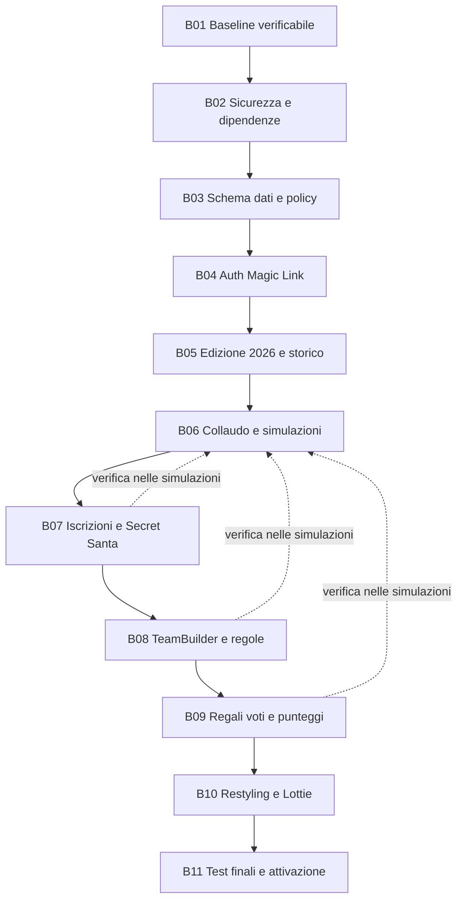

# Fanta Claus — roadmap operativa 2026

Baseline storica: audit del 19 novembre 2026, commit `0b21649`. **Aggiornamento B03+B04+B05, 20 novembre 2026:** nuova architettura 2026 implementata localmente e verificata con 176 test applicativi, 180 controlli PostgreSQL/PGlite e smoke SSR con stub. **B03/B04/B05 implementati, verifica integrale incompleta**; B06–B11 restano previsti. Nessuna modifica o infrastruttura remota, nessuna attivazione ufficiale. B01/B02 conservati con i propri limiti storici. Requisiti/decisioni in [PROJECT_SPEC.md](PROJECT_SPEC.md), esiti in [AUDIT_REPORT.md](AUDIT_REPORT.md), operazioni ancora necessarie nel [runbook](IDENTITY_EDITION_RUNBOOK.md).

Stati ammessi: **previsto** (da avviare), **in corso** (attività effettivamente avviata), **implementato** (codice presente, verifica incompleta), **verificato** (criteri dimostrati). La nuova numerazione B01–B11 sostituisce quella precedente: schema dati e collaudo diventano blocchi espliciti, regali/voti/punteggi hanno un blocco dedicato, UI e Lottie sono riuniti.

## Sequenza e dipendenze

L'ordine indica le dipendenze principali, non un obbligo di completare tutto il tooling prima di proteggere un endpoint. B02a può partire dopo la baseline minima B01a; l'aggiornamento delle dipendenze può avere precedenza se una verifica aggiornata ne dimostra l'urgenza. La ricognizione dello schema e la valutazione dell'isolamento iniziano in B01; la progettazione completa è B03 e il collaudo operativo è B06. Nessuna migrazione va progettata su uno schema soltanto inferito.

B04 realizza identità e profilo; B05 collega la partecipazione all'edizione; B07 applica le iscrizioni e le loro chiusure. I relativi contratti vanno progettati insieme in B03, mantenendo il login degli esistenti dopo la chiusura. B06 prepara isolamento e gestione delle partite di prova, poi acquisisce progressivamente B07–B09: non può certificare voti e classifica prima che siano definite e implementate le regole. Test reali di Auth/DB servono già in B02–B05, senza attendere il pannello simulazioni.

Il TeamBuilder dipende dal sorteggio riuscito, non dallo sblocco del destinatario. D04 e D05/D08 bloccano soltanto le implementazioni che richiedono quelle regole. Analisi UX e raccolta asset possono precedere B10 senza inventare homepage o navigazione. Nessun blocco autorizza implicitamente agenti paralleli, installazioni, accessi remoti o deployment.

## B01 — Baseline e ambiente verificabile

**Priorità:** immediata. **Stato:** implementato; B01a verificato, ricostruzione DB isolata non disponibile. **Dipendenze:** ambito operativo autorizzato; materiale sanificato disponibile per le prove DB.

**Obiettivo:** rendere misurabili i fix senza dati o credenziali di produzione. Riferimenti: AUD-012, AUD-022, Q01–Q06.

**Eseguito:** Node 24.14.0/npm 11.11.1, installazione riproducibile dal lockfile aggiornato, script typecheck/test/check/build isolata/smoke, Vitest con fixture anon/A/B/admin e rete esterna bloccata. 145 test automatici e 33 controlli HTTP con Next compilato/stub locale; lint/tsc/build/audit eseguiti. Nessun CI o DB reale predisposto. **Residuo:** acquisire DDL/grant/RLS e campione 2025 sanificati, ricostruire un DB isolato reale e provare vincoli/policy/recupero. I test fake non soddisfano quel criterio di B01 completo.

- **B01a, primo sottoblocco:** rileggere route privilegiate, chiamanti e sessione; rilevare runtime e dipendenze disponibili; predisporre, nell'ambito autorizzato, baseline riproducibile e test minimi delle guard per anonimo, A, B e admin. Installare dal lock soltanto se autorizzato, senza aggiornamenti incidentali; motivare eventuali strumenti di test.
- Registrare lint, TypeScript e build con esiti distinti, verificando prima eventuali accessi remoti della build. Errori preesistenti e comandi non avviabili restano tali.
- Acquisire da una fonte autorizzata DDL, grant/RLS, vincoli e campione sanificato 2025, senza interrogare implicitamente la produzione. Preparare fixture e DB isolato per le prove pertinenti; non inventare policy mancanti.
- Inventariare configurazioni per soli nomi delle variabili, strumenti, baseline dati e risultati 2025 approvati; valutare il recupero. Definire controlli riproducibili e CI solo nell'ambito concordato, senza deployment automatico.

**Completamento:** comandi e limiti registrati; test minimi di autorizzazione eseguibili senza produzione; disponibilità/assenza di schema e fixture esplicita. B01a può chiudersi con errori preesistenti documentati se consente i test B02a; B01 completo richiede anche la ricostruzione isolata necessaria alle verifiche DB.

## B02 — Correzioni urgenti di sicurezza, integrità e dipendenze

**Priorità:** P0/P1, prima di nuova esposizione pubblica. **Stato:** implementato; verifiche applicative con fixture/stub, garanzie DB incomplete. **Dipendenze:** B01 minimo per i test; schema verificato per interventi DB, D05 per variazioni semantiche dei gifts.

**Obiettivo:** proteggere i flussi 2025 durante la transizione, senza attendere la nuova autenticazione.

**Eseguito:** B02a (guard comune, anteprima/premi protetti, reset disabilitato), B02b applicativo (identità/fasi server, API team, logout comune, difese codici), B02c indipendente dal DB (caricamento/salvataggi/receiver/errori/classifica condivisa), B02d (Next/React e transitive mirate, audit 0). Test rifiuti senza mutazioni nelle fixture, payload manipolati, errori, retry e concorrenza nel processo; formula storica preservata.

**Non chiuso:** Data API/grant/RLS e vincoli reali; atomicità di fase e scrittura e versionamento distribuito; race delete-categoria; snapshot/limite righe classifica; revoca JWT e rate limit multiistanza; E2E browser/DB/hosting; semantica gifts storici D05. Reset rimosso dal codice distruttivo, non sostituito con un nuovo reset. Nessuna modifica schema speculativa. Prima di una release pubblica completare i controlli Q pertinenti e B03/B04/B05: non usare i dati globali attuali come nuova edizione.

- **B02a, primo fix applicativo:** guard server uniforme sulle mutazioni amministrative e sul reset; proteggere awards e anteprima eliminando l'autorità dell'header owner ID. Conservare le letture pubbliche necessarie a home/profilo. AUD-001, AUD-002, AUD-004.
- **B02b:** votante dalla sessione, titolarità e finestre server; protezione squadre e Data API secondo schema/grant/RLS verificati; unificare logout e mitigare i vecchi accessi durante la transizione. AUD-003, AUD-005, AUD-006, AUD-016, AUD-017.
- **B02c:** fermare sovrascritture e false conferme, preservare campi omessi; definire e rendere coerente/atomico il reset oppure disabilitarlo con decisione esplicita. Correggere gli errori di lettura senza cambiare arbitrariamente la formula storica. AUD-008–015, AUD-018, AUD-021. Nessun reset globale per il 2026.
- **B02d:** rivalutare advisory e aggiornamento circoscritto delle dipendenze vulnerabili nell'ambito autorizzato; compatibilità Next/React/MUI/Node, distinzione runtime/tooling e verifica artefatto. Nessun `npm audit fix` automatico o versione scelta dal solo vecchio audit. AUD-007.

**Completamento:** test positivi/negativi anon/A/B/admin per ogni handler protetto; header/body manipolati senza privilegi; richieste fuori fase respinte e nessuna scrittura sui rifiuti; errori/retry/concorrenza coperti. Audit dipendenze aggiornato, segnalazioni critiche/alte risolte o applicabilità valutata con evidenze; lint/tsc/build e regressioni pertinenti registrati. Chiudere problemi soltanto sulla base dei singoli fix verificati.

## B03 — Progettazione e verifica dello schema dati

**Priorità:** alta. **Stato:** implementato e verificato su PostgreSQL/PGlite; Supabase reale e baseline completa da verificare. **Dipendenze:** catalogo legacy completo e dati di riferimento per la produzione; D03 da confermare. D02/D05 restano aperte senza bloccare il nuovo dominio separato.

**Eseguito:** tre migrazioni transazionali, nuovo dominio privato/RPC, RLS forzata/ACL minime/default sicuri, ruoli per edizione senza autoassegnazione, contenitori ufficiale/simulazione e assegnazioni riservate, quarantena delle sette tabelle senza modificare righe. CSV letti e fixture limitata ai fatti disponibili; rollback/ripristino/riapplicazione PGlite e integrità fixture dimostrati. **Residuo bloccante:** inventario completo legacy/oggetti esposti/proprietari, ripristino Supabase e prove Data API/multi-connessione. Le proposte storiche sotto sono ora implementate solo nel perimetro descritto; non sono più una limitazione documentale dell'incarico corrente.

**Obiettivo:** contratti verificabili per identità, profilo, edizione ufficiale e simulazioni, preservando il 2025. Riferimenti: T01/T02/T06, AUD-005, AUD-008, AUD-012, AUD-019, Q01–Q03.

Piano originario conservato per riferimenti; stato attuale e autorizzazione dell'incarico implementativo descritti sopra:

- Distinguere identità Auth, profilo, partecipazione all'edizione e partita di prova/ufficiale. Valutare rappresentazione e ambito dei ruoli, concessione/revoca e più amministratori; non dedurre identità da nome o owner browser.
- Modellare scadenze, chiusura iscrizioni, sorteggio, sblocco e attivazione come condizioni distinte, con invarianti server/DB. Preservare l'accesso degli account esistenti dopo chiusura.
- Valutare scoping di squadre, voti, regali/categorie, configurazioni, risultati e cache; vincoli composti e array/relazioni secondo necessità reali. Non fissare colonne o vincoli che inventino regole 2026 mancanti.
- Progettare transazione e coordinamento del sorteggio, autorizzazioni admin e proiezione del solo destinatario personale; valutare versioni/conflitti per autosave e correzioni admin.
- Definire isolamento tra simulazioni, ufficiale e storico, incluse eliminazioni; migrazione additiva, riconciliazione 2025, backup, rollback/recupero e prove su DB isolato. Nessun collegamento automatico dei vecchi owner alle email.

**Completamento:** schema e policy reali documentati; proposta con alternative e decisioni residue esplicite; matrice permessi/invarianti e piano di migrazione/recupero verificabile. Nel piano originario il blocco era documentale; l'incarico B03–B05 ha autorizzato implementazione e migrazioni locali, senza autorizzare migrazioni remote. Verifiche sullo stack Supabase e sul catalogo completo ancora necessarie.

## B04 — Nuova autenticazione Magic Link e profilo

**Priorità:** alta. **Stato:** implementato, verifiche applicative/SSR con stub; ciclo reale GoTrue/email ancora non verificato. **Dipendenze:** collaudo Supabase locale, configurazione email/URL e conferma D03. Nessun collegamento storico D02 introdotto.

**Eseguito:** Magic Link senza password UI, SSR/proxy/cookie/getUser, callback fisse e conferma esplicita, logout Supabase, profilo e avatar validati, correzione nomi da admin, codici ritirati senza due accessi paralleli. Nuova creazione account e membership separate dall'accesso esistenti; trigger DB evita l'aggiramento della chiusura via Auth diretto. **Residuo bloccante:** GoTrue/Mailpit/PostgREST reali, compatibilità guard identità/hash temporaneo, link/sessioni/browser/cross-device/SMTP pubblico e configurazioni hosting. Suite reale predisposta, tentativo fermato al preflight per CLI/daemon assenti.

**Obiettivo:** Supabase Auth Magic Link email al posto dei codici, senza password. R26-02/R26-06 e T05; il metodo non è più da scegliere.

- Registrazione autonoma senza approvazione né filtro dominio; comunicare che il link WhatsApp aziendale non è un vincolo tecnico di appartenenza.
- Profilo nome, cognome e avatar predefinito; utente modifica solo avatar, admin corregge nome/cognome. Validazioni e permessi server/DB; nessuna promozione autonoma o identità impostata dal browser.
- Verificare sessioni server/client, callback, redirect consentiti, link scaduti/riusati, reinvio, refresh/logout e apertura su browser/dispositivi diversi. Valutare librerie SSR e compatibilità correnti, motivando eventuali dipendenze.
- **Verifica esplicita email:** consegna reale Magic Link, limiti, antispam, tempi e necessità di SMTP per produzione. Confrontare opzioni e costi senza scegliere automaticamente un servizio a pagamento. Nessuna email automatica di gioco.
- Progettare con B05/B07 accesso e nuova iscrizione distinti: non bloccare indiscriminatamente le email Auth alla chiusura. Pianificare dismissione codici/sessioni legacy e associazioni storiche solo se verificate.

**Completamento:** registrazione, login, nuovo accesso e logout reali provati nell'ambiente isolato; callback e consegna email dimostrate; A/B/admin non impersonano altri né alterano ruoli/profili protetti. Test diretti API/Data API; nessuna regressione 2025. Ripetere il test di accesso dopo chiusura con B07, oltre alla verifica iniziale del contratto.

## B05 — Gestione edizione 2026 e conservazione del 2025

**Priorità:** alta. **Stato:** implementato, verificato sulle fixture locali; conservazione/recupero reali da dimostrare. **Dipendenze:** verifiche B03/B04 e backup/ripristino/integrità 2025. Nessuna interpretazione gifts storici richiesta o eseguita.

**Eseguito:** solo 2026 nelle pagine ordinarie, nessuna lista statica autorevole o query legacy dal percorso corrente; scoping tramite partita/edizione/FK e assenza di cache di gioco condivise. Seed inattivo/chiuso; comando admin di attivazione manuale distinto da iscrizioni. Legacy preservato, vecchi handler 410 e sorgenti/test B01+B02 archiviati. **Residuo bloccante:** copia Supabase ripristinata e riconciliata con 2025 reale, test transizioni/isolamento su stack completo e attivazione solo in collaudo. Nessuna attivazione ufficiale o migrazione remota eseguita.

**Obiettivo:** mostrare soltanto il 2026 e predisporre l'attivazione ufficiale manuale dopo collaudo. R26-01, D10, AUD-019.

- Implementare scoping approvato su server, DB, query, configurazioni, cache e operazioni admin. Filtri client non isolano le edizioni.
- Conservare tutti i dati 2025 senza cancellarli o sovrascriverli; migrazione additiva autorizzata, riconciliazione con campioni/risultati approvati e prova di recupero. Nessuna UI storico richiesta.
- Configurare il 2026 senza reset globale e date annuali duplicate nei sorgenti; tempistiche gestite dagli admin. Valori e fuso ufficiale restano da concordare (D06).
- Predisporre il controllo di attivazione manuale admin, inizialmente non attivo; deployment e simulazioni non attivano la partita. Questo blocco non effettua l'attivazione ufficiale.

**Completamento:** app ordinaria espone soltanto il 2026; confronti prima/dopo e recupero dimostrano conservazione 2025; cambi di ID non attraversano edizioni; configurazioni/cache isolate; controllo di attivazione verificato in collaudo.

## B06 — Ambiente di collaudo e simulazioni indipendenti

**Priorità:** fondamentale, prima della partita ufficiale. **Stato:** previsto. **Dipendenze:** B03–B05 per identità/scoping; valutazione isolamento avviabile in B01. Funzioni simulate estese progressivamente con B07–B09 e relative decisioni.

**Obiettivo:** più partite di prova indipendenti, accessibili soltanto agli amministratori autorizzati. R26-07, T04/T06.

- Valutare **seconda istanza Supabase e deployment di collaudo separato**, alternative, limiti e costi. Nessuna infrastruttura o servizio a pagamento scelto automaticamente; provisioning solo in un incarico autorizzato.
- Dimostrare isolamento di database, credenziali, callback Auth, configurazioni, job, cache e log rispetto alla produzione. Una preview Vercel con DB ufficiale non soddisfa il requisito.
- Creare più simulazioni con partecipanti fittizi; simulare fasi e scadenze con meccanismo da progettare, senza alterare il tempo ufficiale. Separare i personaggi fittizi dai test Auth reali, senza richiedere implicitamente una casella email per ogni personaggio.
- Ripetere i sorteggi di prova con nuovi esiti casuali validi; aggiungere squadre, voti e classifica man mano che i blocchi sono pronti. Nessuna regola di simulazione amplia i poteri sui sorteggi ufficiali dopo rivelazione.
- Eliminare una singola simulazione con controllo server/DB dell'ambito, senza toccare altre partite, storico o ufficiale; nessun riuso del reset globale.
- Tenere evidenze distinte per simulazioni funzionali e prove reali di Auth, grant/RLS, transazioni, retry e concorrenza sul DB isolato. Identità fittizie e tempo simulato non certificano la sicurezza.

**Completamento iniziale:** accesso admin verificato, più partite isolate creabili/eliminabili, nessun effetto sull'ufficiale. **Completamento complessivo prima di B11:** fasi, scadenze, sorteggio, squadre, voti e classifica simulabili con regole approvate; eliminazioni e richieste manipolate testate; test reali di sicurezza separatamente superati; attivazione ufficiale ancora manuale.

## B07 — Registrazioni, iscrizioni e Secret Santa

**Priorità:** alta, flusso critico. **Stato:** previsto. **Dipendenze:** B03–B06 e Auth reale; R26-03/R26-04/R26-06. D09 blocca solo le eccezioni rimandate, non il ciclo ordinario già approvato.

**Obiettivo:** iscritti autorevoli e sorteggio riservato, programmato e atomico.

- Chiusura iscrizioni configurabile; iscritti automaticamente nel Secret Santa e nel catalogo squadre, sostituendo la fonte hardcoded. Login degli esistenti consentito dopo chiusura; nuove iscrizioni vietate dopo sorteggio riuscito.
- Esecuzione dopo chiusura con almeno 2 iscritti. Se insufficienti, nessun risultato parziale; proroga iscrizioni e riprogrammazione da admin. Nessuna riapertura implicita dopo annullamento di un sorteggio riuscito.
- Programmazione admin e anticipo manuale con le stesse precondizioni. **Verificare il meccanismo su Vercel:** puntualità/frequenza e limiti del piano, autenticazione job, errori, retry, recupero e concorrenza con esecuzione manuale. Valutare alternative e costi senza servizi scelti a priori.
- Generare e verificare sul server un destinatario per partecipante, destinatari unici, nessuna autoassegnazione; persistere in una transazione con coordinamento e vincoli verificati. Una sequenza di insert Supabase non dimostra atomicità.
- Annullamento/ripetizione prima dello sblocco, sblocco solo manuale. Dopo rivelazione nessun nuovo sorteggio ordinario; nessuna riparazione automatica o procedura straordinaria inventata.
- Endpoint personali dalla sessione, solo proprio destinatario dopo sblocco; admin vede il proprio come partecipante e non quelli altrui. Proteggere RLS/grant, view/RPC, HTML/RSC, rete, cache e log; distinguere admin applicativo da privilegi infrastrutturali.
- Coordinare annullamento sorteggio e finestra TeamBuilder senza inventare la gestione di squadre già composte: se quel caso richiede altre regole, esplicitarle prima di implementarlo.

**Completamento:** test su 0/1/2 e insiemi più grandi, invarianti indipendenti dall'algoritmo, rollback/retry e concorrenza; confini con tempo server. Anon/A/B/admin e job falsificato senza privilegi; nessun destinatario prima dello sblocco, solo il proprio dopo; nessuna mappa altrui in rete/browser/cache/log/Data API. Login esistenti dopo chiusura e blocco nuove iscrizioni dopo successo verificati; programmazione/anticipo, proroga e ripetizione autorizzata provati in collaudo con E2E.

## B08 — TeamBuilder, persistenza e nuove regole

**Priorità:** alta. **Stato:** previsto. **Dipendenze:** B07 per partecipanti/sorteggio, B03–B06; D04 prima delle nuove regole. Punteggi trattati in B09.

**Obiettivo:** squadre persistite con feedback reali. R26-05; AUD-011, AUD-013, AUD-020, AUD-021.

- Disponibilità dopo sorteggio riuscito nella finestra programmata; controlli server/DB oltre alla UI, senza subordinare l'apertura allo sblocco dei destinatari.
- Usare gli iscritti; builder 2025 come riferimento, senza confermare 7 membri, capitano x2 o autoselezione. Definire separatamente le regole mancanti.
- Autosave di ogni modifica più «Salva squadra» per confermare il salvataggio corrente, senza bozze/conferme obbligatorie. Alla scadenza vale l'ultima configurazione persistita; stato locale in attesa distinto dal successo DB.
- Proteggere da sovrascritture, errori iniziali e cache obsolete; decidere controllo versione/serializzazione e conflitti, incluse due tab e correzioni admin. Feedback loading/saving/error/confermato e retry reali.
- Squadre incomplete ammesse con i membri presenti; comportamento senza membri ancora da definire. Dopo chiusura solo admin modifica singole squadre. Un escluso lascia un membro in meno, senza sostituzioni automatiche; il suo Secret Santa resta nella D09.

**Completamento:** regole necessarie approvate; test UI/API/DB positivi e manipolati, prima/esattamente/dopo scadenza, lettura fallita, richieste fuori ordine, più tab e admin post-chiusura. Pulsante/autosave confermano soltanto persistenza reale; squadre parziali ed esclusioni persistono al refresh; E2E in collaudo senza regressione storica.

## B09 — Regali, categorie, votazioni, punteggi e classifica

**Priorità:** alta dopo definizione funzionale. **Stato:** previsto. **Dipendenze:** B03–B08; D05/D06/D07/D08 risolte per l'ambito. Nessuna nuova formula derivata automaticamente dal 2025.

**Obiettivo:** regole approvate e verificabili, separate dal comportamento storico. Riferimenti: AUD-008, AUD-009, AUD-014, AUD-018, AUD-020, AUD-024.

- Definire regali/categorie, destinatario dei punti, voto e finestre/visibilità, classifica finale, ex aequo, pubblicazione e correzioni; chiarire i gifts storici prima di migrare o correggere.
- Esempi indipendenti dal calcolo con donatore/destinatario distinti, bonus/malus e capitano solo se confermato nel 2026; testare ex aequo e squadre incomplete con i membri presenti. Non inventare il trattamento delle squadre vuote.
- Identità dalla sessione, invarianti e tempo server/DB; retry/concorrenza sui voti e feedback reali. Contratti canonici e fallimenti espliciti sulle letture necessarie, senza risultati 200 incompleti.
- Valutare snapshot/congelamento secondo decisioni; misurare completezza query e limiti Data API prima di ottimizzare. Estendere le simulazioni con voti e classifica approvati.

**Completamento:** casi approvati superati da profilo/admin/classifica, fault injection e matrice anon/A/B/admin verificati; E2E votazione→classifica e concorrenza; simulazioni complete e storico riconciliato senza reinterpretazioni arbitrarie.

## B10 — Restyling UI/UX e Lottie

**Priorità:** dopo stabilità dei flussi. **Stato:** previsto. **Dipendenze:** contratti B04–B09 stabili, D11 e UX/UI dettagliate concordate; asset e compatibilità disponibili.

**Obiettivo:** restyling completo responsive, principalmente per smartphone. R26-08/R26-09; AUD-013, AUD-020, AUD-023, AUD-025–027.

- Definire homepage/navigazione prima di implementarle; consolidare token MUI, form, feedback e loading/error/empty, componenti condivisi per duplicazioni reali. Correzioni accessibili necessarie possono accompagnare i blocchi funzionali precedenti.
- Verificare nomi accessibili, tastiera/focus, contrasto, touch e viewport; provare MUI App Router/SSR, CSS e idratazione. Misurare rete, bundle e immagini prima di ottimizzare.
- Inventariare asset Lottie già disponibili, formati/licenze/dimensioni; scegliere un player dopo verifica API, peer dependency, renderer e versioni effettive. Motivare dipendenze e alternative; nessun pacchetto scelto ora.
- Caricamento differito, dimensioni stabili, fallback statico, movimento ridotto, pausa/cleanup ed errori. Animazioni elaborate prevalentemente Lottie; celebrazioni dopo conferma server, mai autorità su persistenza o permessi. Nessuna assegnazione segreta in asset/analytics.

**Completamento:** QA smartphone/desktop, tastiera/screen reader, contrasto e movimento ridotto; compatibilità, prestazioni e fallback Lottie verificati senza errori SSR/idratazione o spostamenti significativi. Flussi critici e test business indipendenti dalle animazioni ancora superati.

## B11 — Test finali e attivazione ufficiale manuale

**Priorità:** obbligatoria. **Stato:** previsto. **Dipendenze:** criteri B01–B10 del perimetro approvato soddisfatti, B06 completo e decisioni necessarie risolte. Eccezioni rimandate esplicitamente fuori perimetro.

**Obiettivo:** candidata verificata sul collaudo isolato, poi attivazione manuale 2026 da parte degli admin.

- Lint, TypeScript, unit/integrazione/E2E pertinenti, build e audit dipendenze aggiornato; versioni nell'artefatto e configurazione Vercel effettiva. Nessuna certificazione dalla sola assenza di advisory.
- **E2E reali critici:** Magic Link/profilo → iscrizione/chiusura → sorteggio programmato o manuale → sblocco personale → squadra/autosave/scadenza → voto/classifica approvati. Provare anche l'attivazione manuale in collaudo e il login dopo chiusura; l'ordine E2E non definisce il calendario ufficiale ancora da configurare.
- Matrici anon/A/B/più admin, privilegi manipolati, RLS/Data API, confini temporali, retry/errori/concorrenza; nessun admin legge assegnazioni altrui. Atomicità e riservatezza verificate anche fuori UI, in log/cache.
- Più simulazioni indipendenti; eliminazione di una senza effetti sulle altre/ufficiale/2025; test Auth/DB reali oltre ai personaggi fittizi. Separazione credenziali, callback, job e deployment; nessuna copia implicita di dati di produzione.
- Consegna Magic Link/SMTP, affidabilità job, conservazione 2025 e recupero backup provati. QA mobile/accessibilità/errori/prestazioni; piano di rollback/recupero e limiti noti documentati.
- Distinguere candidata verificata, eventuale deployment richiesto esplicitamente e attivazione ufficiale manuale dopo collaudo. Nessuna attivazione automatica dalle simulazioni; nessuna email automatica di gioco.

**Completamento:** criteri con evidenze, criticità bloccanti risolte o riclassificate con verifiche reali, candidata e piano operativo approvati; attivazione ufficiale manuale soltanto quando esplicitamente autorizzata. Documentare separatamente «pronta» e «attivata». Questa roadmap non autorizza commit, push, migrazioni remote o deployment.

## Gestione delle sessioni successive

Seguire [AGENTS.md](../AGENTS.md), rileggere i file reali e scegliere un sottoblocco piccolo con criteri dimostrabili. Per implementare usare un branch dedicato concordato; non cambiare branch nella sessione documentale.

Prossimo blocco consigliato: **chiudere i collaudi reali B03–B05**, avviando Docker/CLI, suite Supabase/Mailpit/Data API e QA browser, poi acquisire catalogo completo e provare backup/ripristino 2025 con autorizzazione dedicata. Confermare D03 prima di pubblicare. Quindi B06 simulazioni e B07 sorteggio, senza attivare l'ufficiale. Branch corrente mantenuto `codex/b01-b02`, working tree con B01+B02 e B03–B05 non committati; nessun commit/push/deployment.
